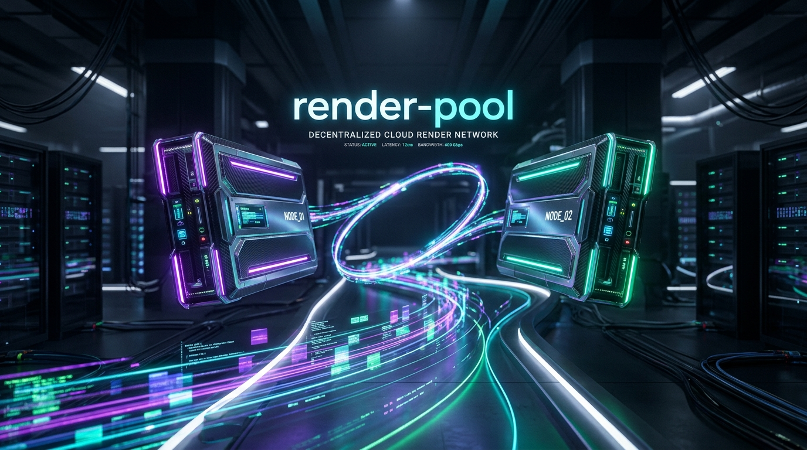
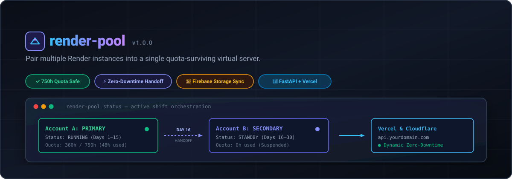

# render-pool



Pairs multiple Render.com accounts into a single, high-availability virtual server that survives free-tier quotas through automated half-month shift rotations, zero-downtime router handoffs, and Firebase Storage disk persistence.

Built for **FastAPI backends** connected to **Vercel frontends**, but compatible with any containerized web service.

---

## Contents

- [The Problem](#the-problem)
- [How It Works](#how-it-works)
- [Architecture](#architecture)
- [Install](#install)
- [Quick Start](#quick-start)
- [Commands](#commands)
- [Filesystem Persistence with Firebase](#filesystem-persistence-with-firebase)
- [Unified Ingress Router](#unified-ingress-router)
- [Development & Testing](#development--testing)
- [License](#license)

---

## The Problem

Render's free tier provides **750 free instance hours per month per account**.
- A single 24/7 service consumes ~720–744 hours per month, sitting on the razor's edge of monthly exhaustion.
- Two services in the same account burn the 750-hour quota in just 15 days.
- Free web services also spin down after 15 minutes of inactivity and have ephemeral disks (all local changes are wiped on restart/deploy).

**render-pool** solves this by pairing 2 (or more) separate Render accounts into an orchestrated pool:
1. **Account A** runs active shifts from Day 1 to Day 15 (~360 hours).
2. **Account B** is **Suspended** via Render API (consuming **0 billable hours**).
3. On Day 16, **Account B** wakes up, polls healthy, takes over public traffic via an edge router, and **Account A** is suspended.
4. Neither account ever exceeds ~360 hours/month (giving you a massive 52% safety buffer).

---

## Architecture



```text
               +--------------------------------------------+
               |        Local Machine / CI / Cron           |
               |        render-pool CLI (The Brain)         |
               +---------------------+----------------------+
                                     |
             +-----------------------+-----------------------+
             |                                               |
             v                                               v
+--------------------------+                   +--------------------------+
|  Render Account A        |                   |  Render Account B        |
|  [DAYS 1 - 15: ACTIVE]   |                   |  [DAYS 16 - 30: STANDBY] |
|  - Fast API Backend      |      Handoff      |  - Suspended (0 hrs used)|
|  - Burns ~360 hrs / mo   | =================>|  - Resumed on Day 16     |
|  - Suspended on Day 16   |                   |  - Burns ~360 hrs / mo   |
+------------+-------------+                   +-------------+------------+
             |                                               |
             |  (Sync on Boot & SIGTERM Flush)               |
             +-----------------------+-----------------------+
                                     |
                                     v
                      +-----------------------------+
                      |   Firebase Storage Bucket   |
                      |   & Firebase Active DB      |
                      |   (Persistent State Layer)  |
                      +-----------------------------+
                                     ^
                                     |
                      +-----------------------------+
                      |    Unified Ingress Router   |
                      | - Cloudflare Worker Proxy   |
                      | - Vercel Edge Rewrite       |
                      +--------------+--------------+
                                     ^
                                     |  HTTP API Calls
                      +--------------+--------------+
                      |       Vercel Frontend       |
                      +-----------------------------+
```

---

## Install

Requires Python 3.8+ (Standard library only; zero external pip dependencies for CLI).

```bash
curl -fsSL https://raw.githubusercontent.com/mr-ceo7/render-pool/main/install.sh | bash
```

Or install locally with pip:

```bash
git clone https://github.com/mr-ceo7/render-pool.git
cd render-pool
pip install -e .
```

---

## Quick Start

### 1. Add your Render accounts
Create an API key in each Render account (**Dashboard -> Account Settings -> API Keys**), then add them to your pool:

```bash
render-pool account add primary
render-pool account add secondary
```

Check pool status:

```bash
render-pool status
```

### 2. Scaffold Firebase persistence in your FastAPI project
Inside your FastAPI repository, run:

```bash
render-pool init
```

This creates:
- `Dockerfile`: Container image configured with graceful sync hooks.
- `entrypoint.sh`: Traps `SIGTERM` and handles flush before shutdown.
- `render_sync.py`: Startup pull and exit push to Firebase Storage.
- `render_pool_router/`: Ready-to-deploy Cloudflare Worker and Vercel Edge templates.

### 3. Deploy across the pool

```bash
render-pool deploy
```

This triggers synchronized deployments across all paired Render accounts so both nodes run identical code.

---

## Commands

| Command | What it does |
|---|---|
| `render-pool status` | Show pool status, active account, shifts, and router info |
| `render-pool account add <name>` | Register a Render account and service into the pool |
| `render-pool account remove <name>` | Remove an account from the pool |
| `render-pool switch [name]` | Trigger safe zero-downtime handoff to another account |
| `render-pool deploy [--active-only]` | Deploy current code to instances in the pool |
| `render-pool check-shift [--auto-switch]` | Verify if a shift change is due; auto-switches if enabled |
| `render-pool init [dir]` | Scaffold Firebase sync, Dockerfile, and Router templates into a project |
| `render-pool router set-cloudflare` | Configure Cloudflare Worker reverse proxy credentials |
| `render-pool router set-vercel` | Configure Vercel Edge Config routing credentials |
| `render-pool ssh [name]` | Open SSH session into the active (or specified) instance |
| `render-pool logs [name]` | Stream live logs from the active instance |
| `render-pool cron install` | Print crontab command to automate Day 1 / Day 16 handoffs |

---

## Filesystem Persistence with Firebase

Render free instances have ephemeral disks. When instances rotate or suspend, local files reset to the Docker image.

`render-pool` bridges this with a transparent Firebase Storage synchronization hook:
1. **On Boot:** `entrypoint.sh` runs `python render_sync.py pull`, extracting the latest snapshot from your Firebase Storage bucket into `/app/data`.
2. **On Shutdown:** When Render sends `SIGTERM` during suspension, the container traps the signal, runs `python render_sync.py push`, and uploads an archive back to Firebase Storage before exiting.

Set these environment variables on your Render services:
- `FIREBASE_STORAGE_BUCKET`: e.g. `your-app.appspot.com`
- `FIREBASE_SERVICE_ACCOUNT_JSON`: Path to service account credentials (or configure Google Application Default Credentials)

---

## Unified Ingress Router

Your Vercel frontend needs a single persistent API URL.

### Option A: Cloudflare Worker (Zero-downtime reverse proxy)
1. Deploy the worker in `render_pool_router/cloudflare-worker.js` with Wrangler:
   ```bash
   cd render_pool_router && npx wrangler deploy
   ```
2. Configure `render-pool`:
   ```bash
   render-pool router set-cloudflare --account-id <ID> --api-token <TOKEN> --script-name render-pool-router --public-url https://api.yourdomain.com
   ```
Whenever `render-pool switch` runs, it updates the Cloudflare Worker target in < 1 second.

### Option B: Vercel Edge Rewrite
If your frontend runs on Vercel, copy `render_pool_router/vercel-middleware.ts` into your Next.js project. It dynamically routes `/api/*` to the active Render backend using Vercel Edge Config.

---

## Automating Shifts with Cron

To automate the Day 1 and Day 16 shift handoffs, add this entry to your crontab (`crontab -e`):

```bash
0 0 * * * ~/.local/bin/render-pool check-shift --auto-switch >> ~/.render_accounts/shift.log 2>&1
```

---

## Development & Testing

Run unit tests:

```bash
python3 -m unittest discover -s tests
```

---

## License

MIT License. Copyright (c) 2026 qassim / mr-ceo7.
